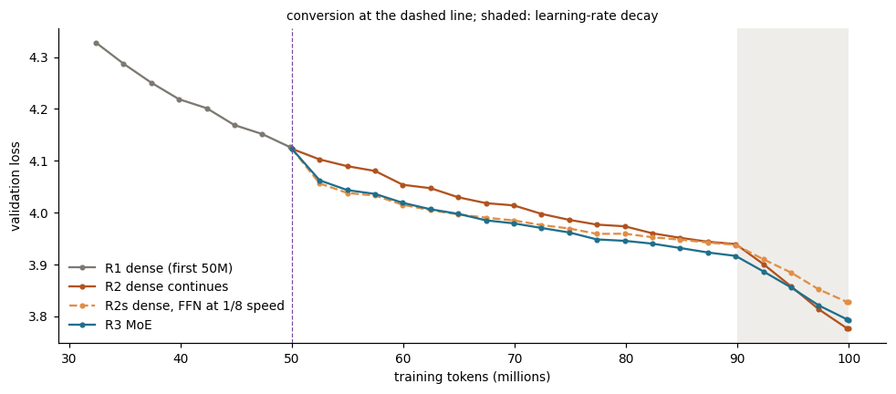
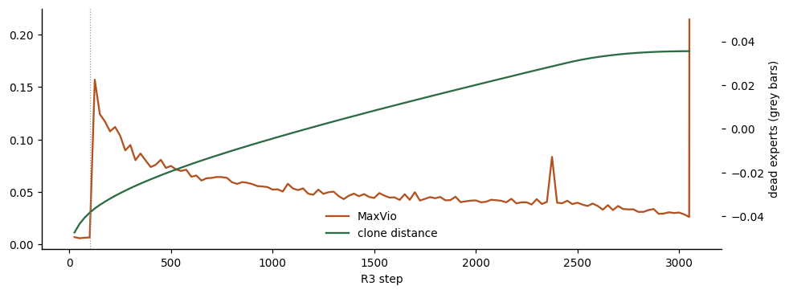

# From a dense model to a mixture of experts

**ERA V5 · Session 14 — Mixture-of-Experts**

> *Train a Linear model and convert that into an MoE! Your call on model size and data trained on, but must show they continue to train and reduce loss!*

Run on a Colab **Tesla T4**. Final notebook (v3) acceptance checks: **17/17 passed**. Every number below is generated from the runs' `outputs/v*/summary.json` files by [`tools/make_readme.py`](tools/make_readme.py); none is typed by hand.

## Reports

Each report is published as a web page, and a standalone copy is in `docs/` to open from disk.

- **Results report: From Dense to Mixture of Experts**: the headline numbers, the path from the first failure to the result in diagrams, this write-up, and every notebook cell with its output.
  - Published: [https://claude.ai/artifact/7Ppswkd1eQZjMJHQR89sQc](https://claude.ai/artifact/7Ppswkd1eQZjMJHQR89sQc)
  - Local copy: [`docs/session14_results.html`](docs/session14_results.html)
- **Notebook walkthrough: The Expert Split**: every cell of the final notebook with what it does, its full source and what it printed on the T4, grouped by task, and a ledger of the ten things this assignment got wrong.
  - Published: [https://claude.ai/artifact/Bus2ncEUUnDkMUxNoZmZsY](https://claude.ai/artifact/Bus2ncEUUnDkMUxNoZmZsY)
  - Local copy: [`docs/session14_walkthrough.html`](docs/session14_walkthrough.html)
- **Build plan and execution record**: every decision with its options, pros and cons; each milestone's results as it happened; the two diagnostics; the build log.
  - Published: [https://claude.ai/artifact/XRCTgwLsgKx272v7qBfSLu](https://claude.ai/artifact/XRCTgwLsgKx272v7qBfSLu)
  - Local copy: [`docs/assignment_plan.html`](docs/assignment_plan.html)
- **Session report: Mixture-of-Experts**: the lesson and transcript in plain English, with the MoE layer drawn step by step, a glossary, and the first approach note for this assignment.
  - Published: [https://claude.ai/artifact/6oW6uEii4374H72jkfhGGn](https://claude.ai/artifact/6oW6uEii4374H72jkfhGGn)
  - Local copy: [`docs/session14_report.html`](docs/session14_report.html)

## The answer in one table

A dense GPT (R1) was trained on 50M tokens, then continued for 50M more tokens three ways from the same checkpoint, on the same tokens in the same order, with the same learning-rate schedule.

| run | what it is | parameters (total / used per token) | final val loss | change since R1 | tokens / s | peak memory |
|---|---|---|---|---|---|---|
| **R1** | dense, first 50M tokens | 22.5M / 22.5M | **4.1230** | — | 54,666 | 4,052 MiB |
| **R2** | dense continues (control) | 22.5M / 22.5M | **3.7757** | -0.3474 | 50,728 | 6,321 MiB |
| **R2s** | dense continues, FFN learning at 1/8 speed (fair control) | 22.5M / 22.5M | **3.8268** | -0.2963 | 49,374 | 6,374 MiB |
| **R3** | **MoE** converted from R1 | 114.4M / 22.6M | **3.7932** | -0.3299 | 16,253 | 11,500 MiB |

Loss is the average cross-entropy per token in nats (lower is better), measured on 327,680 held-out tokens from documents never trained on. Three independent trainings of R1 differed by at most 0.0012, so differences below about 0.002 are noise.

## What the brief asked, answered

**1 · Train a dense model.** R1: 16 layers × width 320, 22.5M parameters (58% of them in the feed-forward layers), 50M FineWeb tokens. Validation loss 9.0792 → **4.1230**.

**2 · Convert it into an MoE.** Each layer's feed-forward network (FFN, 1,280 neurons) was cut into 4 slices of 320 and each slice copied 8 times: **32 experts per layer in 4 families**, one expert per family per token. The MoE stores 114.4M parameters but uses 22.6M per token, the dense model's work plus the routers. The conversion keeps the function: the converted model's logits matched R1's to 1.3e-14 in fp64, and its validation loss was 4.12303 against R1's 4.12303.

**3 · Show it continues to train and reduces loss.** **Yes.** R3's validation loss fell from 4.1230 to **3.7932** (-0.3299) over 50M more tokens, with no expert ever left without tokens.

## How it got there: two diagnostics

The first conversion did **not** keep learning. Two short diagnostic rounds on the T4 found why.

| version | what it tested | what it found |
|---|---|---|
| v2 | the conversion, and a 450-step preview of the MoE training | conversion exact, but validation loss **rose** 4.1230 → 4.1625; after the switch to hard expert selection the load collapsed (MaxVio 0.07 → 1.96) |
| v2.1 | 7 runs of 200 steps, each changing one thing | a 10× slower router stopped the collapse (MaxVio after the switch 0.16 vs 1.96); the loss rose whenever tokens were split across clones, even with a fixed token-to-clone table (+0.0670 vs dense) |
| v2.2 | 6 runs: a smaller learning rate for the experts | experts at 1/8 speed turned +0.0724 into **-0.0331** against dense after 200 steps |
| v3 | 50M tokens: R2, R2s, R3 | the MoE kept learning to 3.7932 (this README) |

**Why the experts needed to learn slower.** After the split, each clone learns from about an eighth of the tokens in a batch, so its gradient is much noisier. Adam still takes full-size steps, so the clones wandered. Storing each expert's weights divided by 8 and multiplying by 8 when used leaves the model's output unchanged, and makes Adam's steps 1/8 as large for those weights.

## Findings

**1 · The MoE's extra parameters helped, measured against a fair control.** Slowing the experts is part of the MoE's recipe, so R2s gives the dense model's FFN the same 1/8 learning speed. R3 finished below R2s by 0.0336. The two were level for the first 15M tokens (R3 − R2s at 10.0M: +0.0038); after that R3 pulled away steadily, -0.0213 by 39.8M tokens and -0.0336 at the end.

**2 · But ordinary dense training finished ahead.** R3 led R2 from the first evaluation until 44.8M tokens (-0.0348 at 10.0M tokens, of which the slower learning explains most: R2s had the same early lead). In the learning-rate decay (the last 20%) R2 gained 0.1635, R3 0.1232 and R2s 0.1108, and R2 finished 0.0175 ahead of R3. A likely reason, not tested: the experts were already taking 1/8-size steps, so shrinking every step at the end gave them less to gain.

**3 · The router's speed decided the balance.** With the router learning at full speed, switching from random to best-score expert selection sent most tokens to one clone per family (v2, v2.1). With the router 10× slower, R3's MaxVio after the switch was at most 0.157 (0.026 at the end, over 25-step windows) and no expert went a single window without tokens. The 8 clones in each family moved steadily apart (relative distance 0.011 → 0.184): they specialised.

**4 · The cost.** Same arithmetic per token, but R3 ran 3.1× slower than R2 (16,253 vs 50,728 tokens/s): 32 small matrix products per layer instead of 2 large ones, plus routing. Peak memory was 11,500 MiB against 6,321 MiB, because memory follows the stored parameters and their optimiser state.

**5 · Two design details that the gates caught.** If each family's chosen weight is rescaled to 1 on its own, the router gets **no gradient** (measured: 0.0e+00, against 2.2e-02 with the four weights rescaled together to sum to 4). And the conversion is exact in maths but not bit for bit: summing four 320-neuron products rounds differently from one 1,280-neuron product (2.1e-06 relative in fp32), so the gate checks in fp64.

## The setup

- **Model:** GPT, 16 layers × width 320, 5 heads, GELU FFN of 1,280, vocabulary 8,192 (our own byte-pair tokenizer), sequence 512.
- **Data:** FineWeb sample-10BT, 100.5M training tokens in shuffled windows. R1 reads the first 50M; R2, R2s and R3 read the next 50M in the same order.
- **Training:** AdamW, batch 32 × 512, learning rate 0.001, weight decay 0.1, β₂ 0.95, clip 1.0, fp16 on a T4. Warmup-stable-decay: R1 never decays; R2, R2s and R3 lower the learning rate over their last 610 of 3,051 steps.
- **MoE (R3):** 4 families × 8 clones per layer, one per family per token; the four chosen scores rescaled to sum to 4; router starts at zero, runs in fp32, output scaled by 0.1 (a 10× slower router); experts at 0.125 learning speed; probabilistic expert selection for the first 100 steps, then the best score; a per-expert bias (step 0.01) for balance plus a 0.0001 per-sequence balance loss; AdamW state copied from R1.

## Limitations

- **One seed per run.** The final gaps (0.0175 to R2, 0.0336 to R2s) are 14× and 27× the measured run-to-run spread, so they are clear, but a second seed would make them firm.
- **One size and one budget.** The lesson's MoE gains are measured at far larger scales and budgets.
- **The decay explanation is untested.** Relaxing the experts' slowdown over time is the run that would test it.
- **The diagnostics ran 200 steps each**; the choice of setting for v3 came from those short runs.

## Files

Every asset of the assignment, linked. All paths are relative to this folder.

**Source**

| file | what it is |
|---|---|
| [`notebook_src.py`](notebook_src.py) | the source of truth: a percent-format script, converted to the notebooks in `notebooks/` by [`tools/py2ipynb.py`](tools/py2ipynb.py) |
| [`plan_src.html`](plan_src.html) | the source of the build plan page, built by [`tools/build_plan.py`](tools/build_plan.py) |
| [`.gitignore`](.gitignore) | keeps checkpoints, tokenised data and the laptop test runs out of the repository |

**Notebooks, one per milestone**

| version | what it added | as handed over | as run on the T4 |
|---|---|---|---|
| v1 | data, the dense model, R1 | [`notebooks/session14_moe_v1.ipynb`](notebooks/session14_moe_v1.ipynb) | [`notebooks/session14_moe_v1_executed.ipynb`](notebooks/session14_moe_v1_executed.ipynb) |
| v2 | the MoE layer, the converter, the gates, a 450-step preview | [`notebooks/session14_moe_v2.ipynb`](notebooks/session14_moe_v2.ipynb) | [`notebooks/session14_moe_v2_executed.ipynb`](notebooks/session14_moe_v2_executed.ipynb) |
| v2.1 | the first diagnostic: 7 runs | [`notebooks/session14_moe_v2.1.ipynb`](notebooks/session14_moe_v2.1.ipynb) | [`notebooks/session14_moe_v2_1_executed.ipynb`](notebooks/session14_moe_v2_1_executed.ipynb) |
| v2.2 | the second diagnostic: 6 runs, the fix | [`notebooks/session14_moe_v2.2.ipynb`](notebooks/session14_moe_v2.2.ipynb) | [`notebooks/session14_moe_v2_2_executed.ipynb`](notebooks/session14_moe_v2_2_executed.ipynb) |
| **v3** | **the full comparison: R2, R2s, R3 (final)** | [`notebooks/session14_moe_v3.ipynb`](notebooks/session14_moe_v3.ipynb) | [`notebooks/session14_moe_v3_executed.ipynb`](notebooks/session14_moe_v3_executed.ipynb) |

**Results, one bundle per milestone** (each zip as downloaded from Colab, unpacked beside it)

| version | bundle | summary | results | run logs |
|---|---|---|---|---|
| v1 | [`era5s14_v1_outputs.zip`](outputs/era5s14_v1_outputs.zip) | [`summary.json`](outputs/v1/summary.json) | [`RESULTS.md`](outputs/v1/RESULTS.md) | [`logs/`](outputs/v1/logs) |
| v2 | [`era5s14_v2_outputs.zip`](outputs/era5s14_v2_outputs.zip) | [`summary.json`](outputs/v2/summary.json) | [`RESULTS.md`](outputs/v2/RESULTS.md) | [`logs/`](outputs/v2/logs) |
| v2.1 | [`era5s14_v2.1_outputs.zip`](outputs/era5s14_v2.1_outputs.zip) | [`summary.json`](outputs/v2.1/summary.json) | [`RESULTS.md`](outputs/v2.1/RESULTS.md) | [`logs/`](outputs/v2.1/logs) |
| v2.2 | [`era5s14_v2.2_outputs.zip`](outputs/era5s14_v2.2_outputs.zip) | [`summary.json`](outputs/v2.2/summary.json) | [`RESULTS.md`](outputs/v2.2/RESULTS.md) | [`logs/`](outputs/v2.2/logs) |
| v3 | [`era5s14_v3_outputs.zip`](outputs/era5s14_v3_outputs.zip) | [`summary.json`](outputs/v3/summary.json) | [`RESULTS.md`](outputs/v3/RESULTS.md) | [`logs/`](outputs/v3/logs) |

**Figures**

| figure | what it shows |
|---|---|
| [`outputs/v1/r1_loss_lr.png`](outputs/v1/r1_loss_lr.png) | R1's loss and its learning rate (warm-up, then flat) |
| [`outputs/v2/v2_preview.png`](outputs/v2/v2_preview.png) | v2's preview: the loss rising after conversion, the load collapsing after the switch |
| [`outputs/v2.1/v21_diagnostic.png`](outputs/v2.1/v21_diagnostic.png) | the first diagnostic: seven runs over 200 steps, loss and balance |
| [`outputs/v2.2/v22_diagnostic.png`](outputs/v2.2/v22_diagnostic.png) | the second diagnostic: the smaller expert learning rate turning the MoE around |
| [`outputs/v3/v3_loss.png`](outputs/v3/v3_loss.png) | the result: R1, then R2, R2s and R3 across 50M more tokens |
| [`outputs/v3/v3_balance.png`](outputs/v3/v3_balance.png) | R3's balance over the run: MaxVio, dead experts, clone distance |
| [`outputs/v3/v3_load.png`](outputs/v3/v3_load.png) | R3's load per expert at the end of the run (the title says "last 25 steps"; it is the final one-step window) |

**Reports** (published links in [Reports](#reports))

| local copy | report |
|---|---|
| [`docs/session14_results.html`](docs/session14_results.html) | Results report: From Dense to Mixture of Experts |
| [`docs/session14_walkthrough.html`](docs/session14_walkthrough.html) | Notebook walkthrough: The Expert Split |
| [`docs/assignment_plan.html`](docs/assignment_plan.html) | Build plan and execution record |
| [`docs/session14_report.html`](docs/session14_report.html) | Session report: Mixture-of-Experts |

**Tools**

| script | what it does |
|---|---|
| [`tools/py2ipynb.py`](tools/py2ipynb.py) | converts `notebook_src.py` into a Colab notebook |
| [`tools/make_readme.py`](tools/make_readme.py) | writes this README from the summaries and checks it |
| [`tools/make_results.py`](tools/make_results.py) | builds the results report |
| [`tools/make_walkthrough.py`](tools/make_walkthrough.py) | builds the notebook walkthrough |
| [`tools/step_harness.css`](tools/step_harness.css) | the walkthrough's stylesheet (from session 10's Step Harness) |
| [`tools/build_plan.py`](tools/build_plan.py) | builds the build plan and execution record from `plan_src.html` and the summaries |
| [`tools/probe_balance.py`](tools/probe_balance.py) | the laptop diagnosis of load collapse at the switch (decision D8) |
| [`diagnosis/balance_cpu.json`](diagnosis/balance_cpu.json) | that diagnosis's measurements |

Cell 19 in `notebook_src.py` has two reporting fixes made after the v3 run (a one-step final balance window, and a conclusion that named only one comparison). The numbers in this README are computed from the saved logs with the fix applied; rerunning v3 reloads every run from Drive and reprints them.

## How to run it

Open `notebooks/session14_moe_v3.ipynb` in Colab with a **T4** runtime and choose Runtime → Run all. Allow the Google Drive mount: the notebook stops if Drive is not mounted, because the long runs depend on it to survive a disconnect. About 80 minutes from scratch (data, R1, R2, R2s, R3); a rerun reloads finished runs from Drive.

## Acceptance checks

Final notebook (v3), run on 30 Sep 2026: **17/17**.

- [x] data: 100M tokens, enough windows for R1 and both continuations
- [x] R1: finished its step budget
- [x] R1: validation loss fell
- [x] R1: never decayed (last learning rate = peak)
- [x] R1: checkpoint reloads to the same validation loss
- [x] conversion: clones hold R1's slices, weights and Adam averages
- [x] G1: converted logits match R1's in fp64
- [x] G1: converted validation loss matches R1's
- [x] G2: every router gets a gradient (joint rescaling)
- [x] G2: the per-family rule gives no router gradient (zero up to rounding)
- [x] G3: bias balancing evens out a skewed toy layer
- [x] G4: parameter counts match the formula
- [x] v3: R2s starts as R1 (slowed FFN keeps the function)
- [x] v3: R2, R2s and R3 finished their steps
- [x] v3: R3 started at R1's validation loss
- [x] G5: the MoE keeps training (loss below the conversion value by more than the noise)
- [x] v3: no dead experts at the end of R3
